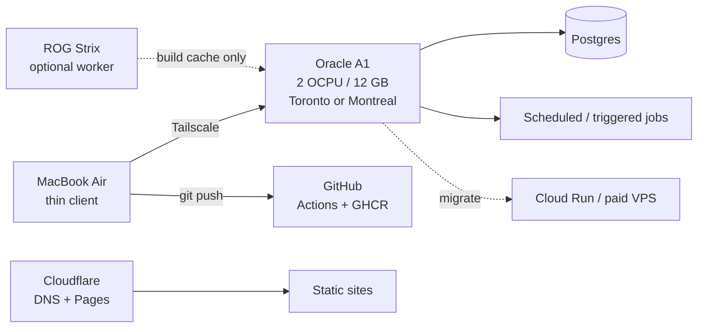

# dev-platform

A zero-cost-first, Canadian platform for Dockerized web services, static sites, and scheduled jobs. It is designed to move to a paid VPS or managed cloud without a rewrite.

**Status: design phase.** Nothing is deployed. `infra/` and `compose/` are scaffolds to validate in Phase 0. Decisions live in `docs/adr/`; unresolved questions live in `docs/grill/brief.md`.

## Why this exists

The development machine is a MacBook Air M1 with 8 GB RAM and a 256 GB disk. It is a good thin client and a poor build server. This repo defines the smallest execution platform that:

- costs **$0** for the first few months,
- runs in **Canada**,
- handles Dockerized web services and scheduled/triggered jobs,
- has free logging, alerting, and backups,
- can move to a paid VPS or managed cloud later.

## Shape

- **Primary node:** Oracle Cloud Always Free `VM.Standard.A1.Flex`, 2 OCPU / 12 GB, Ubuntu 24.04, Docker Compose.
- **Optional worker:** ROG Strix G16 as a `buildx` remote builder, from ~2026-12-06. Never on the critical path (ADR-0002).
- **Static sites:** Cloudflare Pages (free, unlimited bandwidth).
- **CI:** GitHub Actions (2,000 private minutes/month) + GHCR.
- **Access:** Tailscale; no public SSH after bootstrap.
- **Observability:** Uptime Kuma + Dozzle on the box, Healthchecks.io outside it, Sentry free for app errors.
- **State:** Git, Postgres volume + nightly dumps, OCI Object Storage (S3-compatible, 20 GB free).
- **Unified tracker:** GitHub Issues + Projects, with Telegram notifications and a mandatory, drilled FOSS exit.

## Cost

| Item | Phase 1 (hobby) | Phase 2 (client) |
|---|---|---|
| Compute | $0 (Oracle Always Free) | $0–6/mo (Oracle or small VPS) |
| Static hosting | $0 (Cloudflare Pages) | $0 |
| CI | $0 (GitHub Free) | $0–12/mo |
| Monitoring | $0 (free tiers) | $0–20/mo |
| Domain | $0 (provider subdomain) or ~$12/yr | ~$12/yr |
| Database | $0 (Postgres in Docker) | $0 (Neon/Supabase free) → paid |

## Read this first

1. `STRATEGY.md` — what this is for and how it evolves.
2. `docs/architecture.md` — the current design and failure modes.
3. `docs/grill/brief.md` — the questions to settle before building.
4. `docs/plans/0001-phase-0-bootstrap.md` — the first implementation plan.
5. `docs/iterations/README.md` — how work is grouped and closed.
6. `docs/integrations/issue-tracker.md` — intake, labels, alert routing, escape hatch.
7. `GLOSSARY.md` and `docs/adr/` — vocabulary and decisions.

## Working in this repo

- A grilling session → settle open questions; it writes ADRs and updates `GLOSSARY.md`.
- Compound Engineering → run `/ce-setup` once per checkout, then `ce-brainstorm` / `ce-plan` / `ce-work` / `ce-retro` / `ce-compound`; plans live in `docs/plans/`, learnings in `docs/solutions/`.
- `make labels` → create the issue labels used by the templates.
- `make seed-issues` → create the iteration milestones and their issues (idempotent).
- `make iteration` / `make iteration-check` → show progress, and gate the retro.
- `make export` → snapshot the tracker for the FOSS exit.
- `make check` → validate Compose, Terraform formatting, shell scripts, and the iteration manifest.
- `make up` / `make down` / `make logs` → run the local stack (requires `.env`).

## Issue tracking and iterations

One queue for bugs, features, client requests, CI failures, and Sentry errors: **GitHub Issues + Projects**. Templates and labels live in `.github/` and `scripts/create-labels.sh`. Telegram notifications are wired through `.github/workflows/issue-notify.yml`.

Every issue belongs to exactly one **iteration** milestone (`iteration-NN: <theme>`). An iteration ends in a retro, and the retro does not close while the milestone has open issues — except at most two carry-overs, each with a written reason. `make iteration-check` enforces it. Optional work gets its own `optional: true` milestone so it can never block a retro.

## FOSS position

FOSS is a **preference**, not a constraint. The constraint is that a proprietary tool must be escapable: `make export` snapshots issues, labels, and milestones; the import into GitLab or Forgejo has been drilled once; and a tracker-only migration is bounded at one week. If GitHub moves anything in use behind a paid tier, the exit starts immediately. Details in ADR-0005.

## Non-goals (for now)

- A Kubernetes or Nomad "swarm" across free-tier accounts.
- The ROG laptop as anything other than an optional worker (ADR-0002).
- Dual boot. Windows plus WSL2 is acceptable for the optional worker.
- Android emulators.
- Multi-region or high availability.
