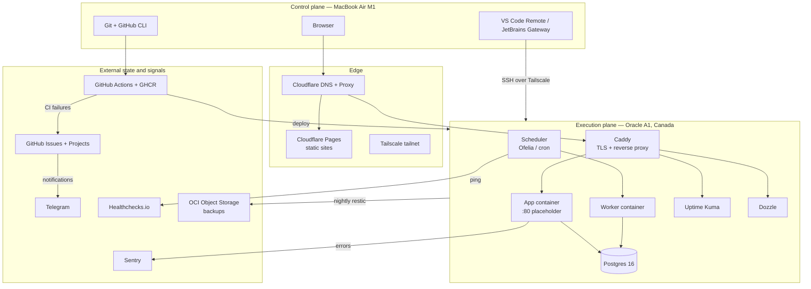

# Architecture

Status: proposed. Nothing is deployed. Date: 2026-11-22.

## Context

The MacBook Air is the control plane. It edits code, runs a browser, and talks to a remote execution plane. The Oracle A1 instance is the execution plane. Durable state lives outside both.



## Planes

| Plane | Runs on | Durable? | Rebuild strategy |
|---|---|---|---|
| Control | MacBook Air | No | Reinstall editor and clone repos |
| Execution | Oracle A1 | No | Terraform + cloud-init + Compose |
| State | GitHub, object storage, Postgres dumps | Yes | Restore from backup |

## Components

| Component | Image / service | Memory budget | Purpose |
|---|---|---|---|
| Caddy | `caddy:2-alpine` | 50–100 MB | TLS, reverse proxy, compression |
| App | Built from app repo | 0.5–1.5 GB | Web service |
| Worker | Same image, different command | 0.5–1 GB | Triggered and background jobs |
| Postgres | `postgres:16-alpine` | 1–2 GB | Primary database |
| Uptime Kuma | `louislam/uptime-kuma:1` | 200–400 MB | Internal uptime dashboard |
| Dozzle | `amir20/dozzle:v8` | 50–100 MB | Container log viewer |
| Scheduler | Ofelia or host cron | < 50 MB | Scheduled jobs |
| OS + Docker | Ubuntu 24.04 | 1–1.5 GB | Host |

Total steady-state: roughly 4–6 GB of 12 GB, leaving 6–8 GB for page cache and bursts. The 2 OCPU limit is the real constraint for compilation, which is why builds run in GitHub Actions.

External services that are not on the Oracle node: GitHub Issues + Projects (triage), Cloudflare (DNS and Pages), Sentry (errors), Healthchecks.io (dead-man's switch), and Telegram (notifications).

## Request flow

### Static site

1. Build runs in Cloudflare Pages or GitHub Actions.
2. Assets are served from Cloudflare's edge.
3. The Oracle node is not involved.

### Dynamic web service

1. Client resolves the domain through Cloudflare.
2. Cloudflare proxies to the Oracle public IP (or a Tunnel).
3. Caddy terminates TLS and proxies to `app:80` (the scaffold uses an nginx placeholder; change the upstream when the real app listens on another port).
4. The app reads/writes Postgres over the Compose network.
5. Errors go to Sentry; logs stay in Docker and are visible in Dozzle.

## Job flow

### Scheduled

1. Ofelia (or host cron) starts a one-shot container on a schedule.
2. The job writes results to Postgres or object storage.
3. On success, it pings a Healthchecks.io check.
4. If the ping does not arrive, Healthchecks alerts by email.

### Triggered

1. A webhook or user action writes a job row to Postgres (or a queue table).
2. The worker claims the row with `FOR UPDATE SKIP LOCKED`.
3. The worker retries with backoff and records the outcome.
4. A dead-man's switch alerts if the queue stops draining.

Start with Postgres-backed jobs. Add Redis only if throughput demands it.

## Deploy flow

```mermaid
sequenceDiagram
  participant Dev as Developer
  participant GH as GitHub Actions
  participant Reg as GHCR
  participant Box as Oracle A1
  Dev->>GH: push to main
  GH->>GH: test, build multi-arch image
  GH->>Reg: push image by SHA
  GH->>Box: ssh (Tailscale) and run deploy.sh
  Box->>Reg: pull image by SHA
  Box->>Box: docker compose up -d
  Box-->>GH: health check result
```

Rules:

- Deploy by immutable tag (commit SHA), never `latest`.
- Keep the previous image tag for rollback.
- Run migrations as a separate, explicit step with a backup first.
- A failed health check stops the deploy and restores the previous tag.

## Issue and alert flow

1. A new bug, feature, or client request arrives through an issue template and gets `status:triage`.
2. `issue-notify.yml` posts the issue to Telegram; email notifications are native.
3. A CI failure on `main` opens or comments on one issue labeled `source:ci`; it is deduplicated by workflow name.
4. Sentry creates or links an issue for a new error group with `source:sentry`.
5. Uptime and cron alerts go to Telegram only. A persistent alert becomes a `type:ops` issue, so the tracker does not fill with transient noise.
6. A PR body with `Closes #123` closes the issue on merge.

Labels, project fields, and the migration path are defined in `docs/integrations/issue-tracker.md`.

## Backup flow

1. Nightly `pg_dump` to a compressed file.
2. `restic` encrypts and uploads the dump plus selected volumes to OCI Object Storage.
3. Retention: 7 daily, 4 weekly, 3 monthly.
4. Monthly restore drill into a scratch database.
5. Healthchecks.io pings on backup success; silence triggers an alert.

## Region choice

| Region | Key | Notes |
|---|---|---|
| Toronto | `ca-toronto-1` | Best for Ontario users; one availability domain |
| Montreal | `ca-montreal-1` | Good alternative; one availability domain |

The OCI home region is chosen at signup and cannot be changed. Decide before creating the tenancy. If A1 capacity fails in one region, the practical fallback is to create the account in the other, because Always Free compute must run in the home region.

## Failure modes

| Failure | Impact | Detection | Recovery | Target |
|---|---|---|---|---|
| Instance reclaimed or stopped | All services down | External uptime check | Rebuild from IaC, restore DB | 1 h |
| A1 capacity prevents rebuild | Extended outage | Provisioning error | Rebuild on a paid VPS or another cloud | 4 h |
| Disk full | Postgres/app errors | Disk alert at 80% | Prune images/logs; expand block volume | 30 min |
| Postgres corruption | Data loss since last dump | App errors, failed queries | Restore latest dump | 1 h, RPO 24 h |
| Bad deploy | App broken | Health check fails | Roll back to previous image tag | 10 min |
| TLS expiry | Browser warnings | External TLS check | Caddy reload; fix DNS/ACME | 30 min |
| DNS/Cloudflare misconfiguration | Site unreachable | External check | Restore DNS record; lower TTL | 30 min |
| Compromised host | Data/credential risk | Unexpected processes, alerts | Snapshot for forensics, rotate secrets, rebuild | 4 h |
| Free-tier policy change | Cost or outage | Provider notice, billing | Migrate using the portability plan | 1 week |
| Tracker outage | Notifications delayed; work continues | Missing Telegram message | Use email; retry; no data loss | 1 h |

## Portability

The exit path is a property of the app, not the provider:

- Stateless HTTP services → Cloud Run, Azure Container Apps, or a paid VPS.
- Postgres → managed Postgres (Neon, Supabase, Cloud SQL) with a dump/restore.
- Scheduled jobs → Cloud Run Jobs, GitHub Actions, or a worker on the new host.
- Static sites → already on Cloudflare Pages.
- Issues → export through the tracker's REST API; keep the original ID in the body; import into GitLab or Forgejo.
- Secrets → re-created from the password manager; nothing provider-specific in code.

Migration triggers:

- Sustained CPU > 70% or memory > 80%.
- A client requires an SLA or maintenance window.
- More than one stateful client database on the box.
- A need for zero-downtime deploys.
- Free-tier egress or capacity becomes limiting.

## Security model

- Public surface: 80/443 only. SSH is closed after bootstrap; admin uses Tailscale SSH.
- UFW default deny; fail2ban for the bootstrap window.
- Unattended security upgrades; reboot window documented.
- Postgres listens only on the Compose network.
- Secrets live in `.env` with mode 600, owned by the deploy user.
- Restic repositories are encrypted; keys are stored in the password manager.
- Dozzle mounts the Docker socket read-only. Treat access to it as admin access.
- Cloudflare proxy hides the origin IP; direct-to-IP access is blocked at the firewall if a Tunnel is used.

## Open questions

See `docs/grill/brief.md`.
