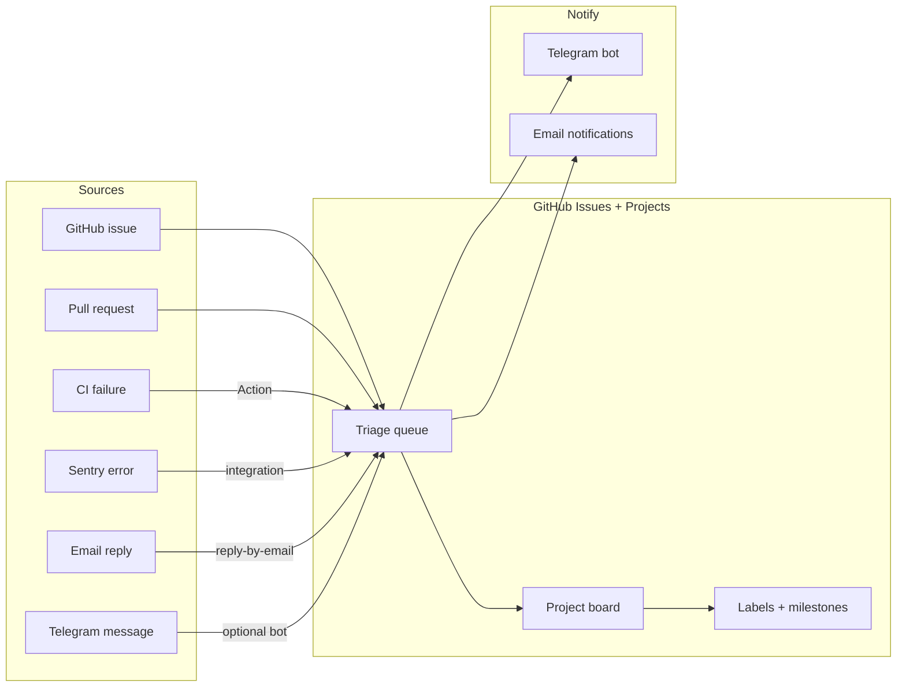

# Unified issue tracker

Status: proposed. The tracker choice is recorded in `docs/adr/0005-issue-tracker.md`.

## Purpose

One intake and one queue for:

- bugs and feature requests,
- client requests,
- CI failures,
- application errors from Sentry,
- operational work that is not an incident,
- optional email and Telegram submissions.

The tracker is not a second copy of the code. It links to repositories and CI, and it is the place where work is triaged and closed.

## Requirements

| Requirement | Weight |
|---|---|
| Generous free tier | Must |
| Good REST API | Must |
| Telegram notifications | Must |
| Email notifications | Should |
| Link to repositories | Must |
| Link to CI/CD | Must |
| FOSS | Preferred |
| Hosted now, self-host later | Should |

## Options

Checked November 2026. Limits change; verify before committing.

| Option | License | Free tier | REST API | Telegram | Email | Repo link | CI link | Self-host |
|---|---|---|---|---|---|---|---|---|
| **GitHub Issues + Projects** | Proprietary | Unlimited issues, 2,000 Actions min/mo | REST + GraphQL | Via Action | Native | Native | Native | No |
| **GitLab Free** | Open-core (CE is MIT) | Unlimited issues, 5 users, 400 CI min/mo, 10 GB/project | REST | Native | Native | Native | Native | Yes (CE) |
| **Plane Cloud** | AGPL-3.0 | 12 users, core PM, in-app Intake | REST + webhooks | Bridge | Native | Paid (Pro) | Webhooks | Yes (CE) |
| **Huly Cloud** | EPL-2.0 | Unlimited users, unlimited objects, 10 GB | SDK-first, partial REST | Native | Native | Native GitHub sync | Webhooks | Yes (heavy) |
| **YouTrack Free** | Proprietary | 10 users, 30 GB, full features | REST | Via workflow | Native | Native GitHub/GitLab | Native | Paid server |
| **Taiga Cloud** | FOSS | 1 public + 1 private project (varies) | REST | Bridge | Native | Webhooks | Webhooks | Yes |
| **Forgejo** | GPL | Self-host only | REST | Webhook | Native | Native | Forgejo Actions | Yes |

## Recommendation

**Phase 0/1: GitHub Issues + Projects.** This is a deliberate, reversible exception to the FOSS preference.

Why:

- The code and CI are already on GitHub. Issues, pull requests, checks, Dependabot, and Sentry integration are native, not bolted on.
- Unlimited issues, 2,000 private Actions minutes per month, and the best API surface (REST + GraphQL).
- Telegram is a 30-line Action; email notifications and reply-by-email are built in.
- One less account, one less integration, one less failure mode during the $0 phase.
- The exit path is documented and testable.

The tradeoff is real: GitHub is proprietary. If FOSS is a hard constraint rather than a preference, choose **GitLab Free** instead. It is the only hosted option that natively covers issues, repositories, CI, REST, and Telegram. The cost is moving or mirroring the repo and accepting the 5-user / 400-CI-minute free tier.

## Topology

## Data model

### Labels

| Group | Values |
|---|---|
| Type | `type:bug`, `type:feature`, `type:client`, `type:ops`, `type:docs` |
| Priority | `priority:p0`, `priority:p1`, `priority:p2`, `priority:p3` |
| Status | `status:triage`, `status:blocked`, `status:waiting-client` |
| Source | `source:ci`, `source:sentry`, `source:telegram`, `source:email` |
| Area | `area:infra`, `area:app`, `area:docs` |
| Client | `client:<slug>` |
| Size | `size:s`, `size:m`, `size:l` |

Keep the set small. A label that is not used to filter or automate should not exist.

### Project fields

| Field | Values |
|---|---|
| Status | Triage, Backlog, Next, In progress, Blocked, Done |
| Priority | P0–P3 |
| Source | Issue, CI, Sentry, Telegram, Email |
| Client | None, or a client slug |
| Repo | `dev-platform`, or an app repo |

### Views

- **My queue** — assigned to me, not Done.
- **Triage** — `status:triage`, sorted by priority.
- **CI failures** — `source:ci`, open.
- **Client work** — `type:client`, grouped by client.
- **Roadmap** — milestone, not Done.

## Event flows

### New issue

1. Author picks a template (bug, feature, client request, ops).
2. Template applies `type:*` and `status:triage`.
3. `issue-notify.yml` posts the issue to Telegram.
4. Triage sets priority, area, client, and moves it to Backlog or Next.

### Pull request

1. PR body contains `Closes #123`.
2. CI runs required checks.
3. Merge closes the issue and moves the project item to Done (native automation or a small Action).

### CI failure

1. A workflow on `main` fails.
2. A follow-up workflow opens one issue labeled `source:ci` and `priority:p1`, or comments on the existing open issue with the same workflow name.
3. Deduplicate by workflow name, not by run ID, to avoid a new issue per retry.
4. Closing the issue requires a green run.

### Sentry error

1. Sentry's GitHub integration creates or links an issue for a new error group.
2. The issue gets `type:bug`, `source:sentry`, and the release tag.
3. Sentry resolves the issue when the release no longer contains the error, or a human closes it with a note.

### Uptime and cron alerts

Do **not** open an issue for every alert. Route uptime and cron failures to Telegram. If the alert persists past its grace period, a human opens an `type:ops` issue with the alert history.

### Email

- Outbound: GitHub notifications and reply-by-email for comments.
- Inbound new issue: optional bridge (IMAP → GitHub API). Not Phase 1.

### Telegram

- Outbound: new issue, reopened issue, and optionally a daily digest.
- Inbound: optional bot command `/issue <title>` that creates an issue via the API. Not Phase 1.

## Setup checklist

- [ ] Create labels with `scripts/create-labels.sh`.
- [ ] Enable the issue templates in `.github/ISSUE_TEMPLATE/`.
- [ ] Create one GitHub Project and add the views above. `gh` needs the `project` scope; the browser is fine.
- [ ] Create a Telegram bot with `@BotFather`, add it to a private channel or group, and store `TELEGRAM_BOT_TOKEN` and `TELEGRAM_CHAT_ID` as Actions secrets.
- [ ] Install the Sentry GitHub integration and scope it to the platform repos.
- [ ] Protect `main`: require the `ci` check and one review for client repos.
- [ ] Add a weekly 20-minute triage block.

## Security

- Bot tokens live in GitHub Actions secrets, never in the repo.
- The Telegram chat is private. A public channel leaks issue titles.
- No secrets, customer data, or personal data in issue bodies. Sentry must scrub PII before it reaches GitHub.
- A bridge that accepts webhooks verifies signatures and rate-limits.
- Use a fine-grained token or GitHub App with only `issues: write` and `contents: read` for automation.

## Migration and exit

To move to GitLab Free or Forgejo:

1. Export issues with `GET /repos/{owner}/{repo}/issues?state=all&per_page=100`.
2. Map labels and states to the target.
3. Create issues through the target's REST API, preserving the original number in a `legacy-id` line in the body.
4. Keep the old tracker read-only for one month.
5. Update links in docs and PR templates.

Test the export on one repository before moving everything.

## Cost

$0 on GitHub Free. Telegram, Sentry Developer, and email notifications are free at this scale.

## Open questions

- Is FOSS a hard constraint or a preference? If hard, switch to GitLab Free now.
- One shared project or one project per client?
- Should clients see a filtered view, or is a status page enough?
- Is inbound email-to-issue worth a bridge?
- Is two-way Telegram (create/close from chat) worth the bot maintenance?
